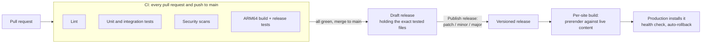

# personal-website

A self-hosted personal website with a full CMS: a public site (blog, freeform pages, docs,
projects, contact, payments, AI demos) and an admin side with a Lexical rich-text editor, staff
roles and analytics. It runs [colinpetree.com](https://colinpetree.com).

**Stack:** Python / Flask, SQLAlchemy, PostgreSQL · React 19, React Router 7 (prerendered),
Vite, Tailwind CSS · nginx, Varnish, gunicorn on ARM64 (AWS Graviton) · GitHub Actions.

## How a change reaches production

- **Build once, promote the artifact.** A release is the draft CI already tested, relabelled with
  its version. Nothing is rebuilt between testing and shipping.
- **Versions come from git tags.** No version-bump commits.
- **Production pulls, CI never pushes.** Servers install the newest release on a timer, check
  health, and roll back on failure.

## What CI checks

| Stage | What it proves |
|---|---|
| **Lint** | ruff (Python), ESLint with React hooks rules, shellcheck on every deploy script, actionlint on every workflow |
| **Backend tests** (pytest, real Postgres) | Every admin route refuses anonymous requests (found from the app's own route table, so new routes are covered automatically); the staff role hierarchy holds; secrets are encrypted at rest and never returned; Stripe webhooks need a valid signature; cross-site writes are blocked; rate limits trip; drafts stay private; publishing triggers a rebuild. Run with the AI demo routes both off and on. |
| **Frontend tests** (Vitest) | The editor's custom nodes export the expected HTML and survive a save/reload round trip; layout and list helpers |
| **Server config** | `nginx -t` and `varnishd -C` on the shipped configs, with the same Ubuntu packages and substitutions production uses |
| **Security** | CodeQL on every change and weekly; dependency review on pull requests; Dependabot for pip, npm and Actions; a monthly audit of what production actually runs |
| **ARM64 build** | The backend is frozen with PyInstaller on the same CPU as production |
| **Migrations** | Applied to a fresh database, and as an upgrade from the previous release's own binary |
| **Prerender** | Sample content builds into real pages; drafts are never prerendered; every inline script matches the page's Content Security Policy |
| **Browser tests** (Playwright) | Public pages hydrate with no console errors or CSP violations; navigation, dropdowns and the mobile menu work; an admin signs in, writes and publishes a page in the editor, sees it on the public site, and signs out. Failures upload a screenshot and trace. |

Merging to `main` requires these checks to pass. Every action is pinned to a commit SHA and
every job runs with least-privilege permissions.

**Not covered by CI:** `install.sh` needs systemd, nginx and certificates on a real host, so it
is exercised by test deployments of a branch rather than in CI. Database migrations are
forward-only: rolling back a release does not undo a schema change.

## Running it locally

See [CLAUDE.md](CLAUDE.md) for setup, local tests and architecture, [RELEASING.md](RELEASING.md)
for the release process, and [DEPLOYMENT_INSTRUCTIONS.md](DEPLOYMENT_INSTRUCTIONS.md) for a new
server.
